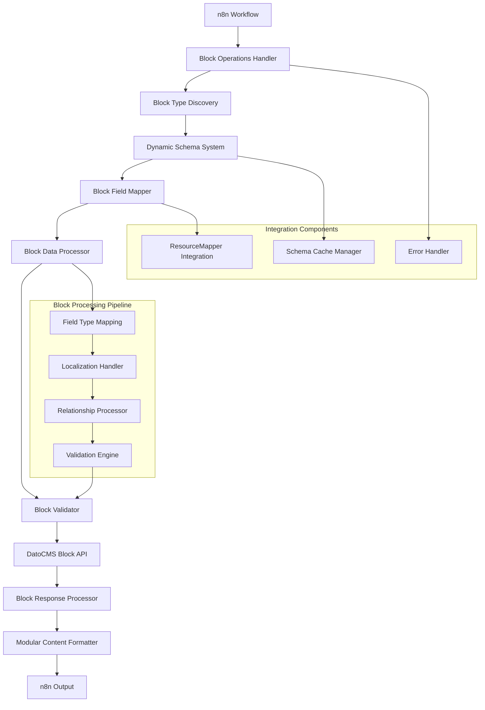

# Design Document

## Overview

The Block Management System enables the creation and management of modular content blocks within the DatoCMS n8n node. It provides a specialized interface for creating structured, reusable content blocks that integrate seamlessly with DatoCMS's modular content architecture. The system leverages the Dynamic Schema System for automatic block type discovery and field mapping, while providing comprehensive validation and error handling specifically tailored for block operations.

## Architecture

### High-Level Architecture



### Component Architecture

The Block Management System consists of several specialized components:

1. **Block Operations Handler**: Manages block-specific operations and workflow
2. **Block Type Discovery**: Discovers and filters modular block types
3. **Block Field Mapper**: Maps block fields using ResourceMapper integration
4. **Block Data Processor**: Processes and transforms block field data
5. **Block Validator**: Validates block data against schema constraints
6. **Modular Content Formatter**: Formats blocks for modular content integration

## Components and Interfaces

### Block Operations Handler

**Purpose**: Orchestrate block operations and manage the block creation workflow

**Key Interfaces**:
```typescript
interface BlockOperationsHandler {
  createBlock(blockTypeId: string, fieldData: any, options: BlockCreationOptions): Promise<BlockResult>;
  validateBlockType(blockTypeId: string): Promise<BlockTypeValidation>;
  processBlockFields(fields: ResourceMapperFields, inputData: any): Promise<ProcessedBlockData>;
  formatForModularContent(blockResult: BlockResult): ModularContentBlock;
}

interface BlockCreationOptions {
  validateOnly?: boolean;
  includeMetadata?: boolean;
  skipValidation?: boolean;
}

interface BlockResult {
  id: string;
  type: string;
  attributes: Record<string, any>;
  relationships?: Record<string, any>;
  meta: {
    blockType: string;
    blockTypeName: string;
    createdAt: string;
    fieldCount: number;
  };
}

interface BlockTypeValidation {
  isValid: boolean;
  blockType: ItemType;
  errors: string[];
  warnings: string[];
}

interface ProcessedBlockData {
  data: Record<string, any>;
  metadata: {
    fieldCount: number;
    localizedFields: string[];
    requiredFields: string[];
    processedAt: string;
  };
}

interface ModularContentBlock {
  id: string;
  type: string;
  attributes: Record<string, any>;
  relationships?: Record<string, any>;
}
```

### Block Type Discovery Component

**Purpose**: Discover and manage modular block types with filtering and validation

**Key Interfaces**:
```typescript
interface BlockTypeDiscovery {
  discoverBlockTypes(filter?: string): Promise<BlockType[]>;
  validateBlockType(blockTypeId: string): Promise<boolean>;
  getBlockTypeSchema(blockTypeId: string): Promise<BlockTypeSchema>;
  cacheBlockTypes(blockTypes: BlockType[]): void;
}

interface BlockType {
  id: string;
  name: string;
  apiKey: string;
  description?: string;
  fieldCount: number;
  isModularBlock: true;
  createdAt: string;
  updatedAt: string;
}

interface BlockTypeSchema {
  blockType: BlockType;
  fields: FieldSchema[];
  validation: ValidationSchema;
  relationships: RelationshipSchema[];
}
```

**Block Type Filtering Logic**:
```typescript
const discoverBlockTypes = async (filter?: string): Promise<BlockType[]> => {
  const credentials = await this.getCredentials('datoCmsApi');
  const client = buildClient({
    apiToken: credentials.apiToken as string,
    environment: credentials.environment as string,
  });
  
  try {
    // Check cache first
    const cacheKey = `blockTypes_${filter || 'all'}`;
    let itemTypes = cache.get<ItemType[]>(cacheKey);
    
    if (!itemTypes) {
      itemTypes = await client.itemTypes.list();
      cache.set(cacheKey, itemTypes, 300000); // 5 minutes
    }
    
    // Filter for modular blocks only
    const blockTypes = itemTypes
      .filter(itemType => itemType.modular_block === true)
      .filter(blockType => !filter || blockType.name.toLowerCase().includes(filter.toLowerCase()))
      .map(blockType => ({
        id: blockType.id,
        name: blockType.name,
        apiKey: blockType.api_key,
        description: blockType.description,
        fieldCount: blockType.fields?.length || 0,
        isModularBlock: true,
        createdAt: blockType.created_at,
        updatedAt: blockType.updated_at
      }));
    
    return blockTypes;
  } catch (error) {
    throw new NodeOperationError(this.getNode(), `Failed to load block types: ${error.message}`);
  }
};
```

### Block Field Mapper Component

**Purpose**: Map block fields using ResourceMapper with block-specific configurations

**Key Interfaces**:
```typescript
interface BlockFieldMapper {
  generateBlockFields(blockTypeId: string): Promise<ResourceMapperFields>;
  mapBlockFieldTypes(fields: FieldSchema[]): ResourceMapperField[];
  validateBlockFieldMapping(mapping: ResourceMapperFields, schema: BlockTypeSchema): ValidationResult;
  processBlockFieldData(mapping: ResourceMapperFields, inputData: any): ProcessedFieldData;
}

interface ResourceMapperField {
  id: string;
  displayName: string;
  type: FieldType;
  required: boolean;
  defaultMatch: boolean;
  description?: string;
  blockSpecific?: {
    isBlockField: true;
    blockContext: string;
    allowedInBlocks: boolean;
  };
}

interface ProcessedFieldData {
  [fieldKey: string]: any;
}
```

**Block Field Processing Logic**:
```typescript
const generateBlockFields = async (blockTypeId: string): Promise<ResourceMapperFields> => {
  const credentials = await this.getCredentials('datoCmsApi');
  const client = buildClient({
    apiToken: credentials.apiToken as string,
    environment: credentials.environment as string,
  });
  
  try {
    // Load block type fields
    const fields = await client.fields.list(blockTypeId);
    
    // Sort fields by position
    fields.sort((a: any, b: any) => (a.position || 0) - (b.position || 0));
    
    const mappedFields: ResourceMapperField[] = [];
    
    for (const field of fields) {
      const fieldType = fieldTypeMapping[field.field_type] || 'string';
      const isLocalized = field.localized === true;
      const isRequired = !!(field.validators as any)?.required;
      const isUnique = !!(field.validators as any)?.unique;
      
      // Build display name with block context indicators
      let displayName = field.label;
      if (isUnique) displayName += ' (Unique)';
      if (isLocalized) displayName += ' (Localized)';
      displayName += ' [Block Field]';
      
      mappedFields.push({
        id: field.api_key,
        displayName,
        type: isLocalized ? 'string' : fieldType, // Use string for localized fields
        required: isRequired,
        defaultMatch: false, // Blocks typically don't use matching
        description: `Block field: ${field.label}${field.hint ? ` - ${field.hint}` : ''}`,
        blockSpecific: {
          isBlockField: true,
          blockContext: 'modular_content',
          allowedInBlocks: true
        }
      });
    }
    
    return { fields: mappedFields };
  } catch (error) {
    throw new NodeOperationError(this.getNode(), `Failed to load block fields: ${error.message}`);
  }
};
```

### Block Data Processor Component

**Purpose**: Process and transform block field data for DatoCMS API consumption

**Key Interfaces**:
```typescript
interface BlockDataProcessor {
  processFieldData(fields: ResourceMapperFields, inputData: any, schema: BlockTypeSchema): ProcessedBlockData;
  transformFieldTypes(data: Record<string, any>, fieldSchemas: FieldSchema[]): Record<string, any>;
  handleLocalizedFields(data: Record<string, any>, localizedFields: string[]): Record<string, any>;
  validateFieldConstraints(data: Record<string, any>, constraints: ValidationConstraint[]): ValidationResult;
}

interface ValidationConstraint {
  field: string;
  type: 'required' | 'length' | 'range' | 'format' | 'unique';
  parameters: any;
  message: string;
}
```

**Field Data Processing Implementation**:
```typescript
const processFieldData = (fields: ResourceMapperFields, inputData: any, schema: BlockTypeSchema): ProcessedBlockData => {
  const processedData: Record<string, any> = {};
  const fieldInfos = createFieldInfoMap(schema.fields);
  
  // Process each mapped field
  Object.entries(fields.mappingMode === 'defineBelow' ? fields.value || {} : {}).forEach(([key, value]) => {
    if (value !== undefined && value !== null && value !== '') {
      const fieldInfo = fieldInfos[key];
      let processedValue = value;
      
      try {
        // Handle localized fields
        if (fieldInfo?.localized && typeof value === 'string' && value.trim().startsWith('{')) {
          processedValue = JSON.parse(value);
        }
        
        // Handle type conversions
        switch (fieldInfo?.field_type) {
          case 'integer':
            processedValue = parseInt(value as string, 10);
            break;
          case 'float':
            processedValue = parseFloat(value as string);
            break;
          case 'boolean':
            processedValue = Boolean(value);
            break;
          case 'date':
          case 'datetime':
            processedValue = new Date(value as string).toISOString();
            break;
        }
        
        processedData[key] = processedValue;
      } catch (error) {
        throw new Error(`Error processing field ${key}: ${error.message}`);
      }
    }
  });
  
  return {
    data: processedData,
    metadata: {
      fieldCount: Object.keys(processedData).length,
      localizedFields: schema.fields.filter(f => f.localized).map(f => f.apiKey),
      requiredFields: schema.fields.filter(f => f.required).map(f => f.apiKey),
      processedAt: new Date().toISOString()
    }
  };
};
```

### Block Validator Component

**Purpose**: Validate block data against schema constraints and business rules

**Key Interfaces**:
```typescript
interface BlockValidator {
  validateBlockData(data: ProcessedBlockData, schema: BlockTypeSchema): BlockValidationResult;
  validateRequiredFields(data: Record<string, any>, requiredFields: string[]): FieldValidationResult[];
  validateFieldTypes(data: Record<string, any>, fieldSchemas: FieldSchema[]): FieldValidationResult[];
  validateFieldConstraints(data: Record<string, any>, constraints: ValidationConstraint[]): FieldValidationResult[];
}

interface BlockValidationResult {
  isValid: boolean;
  errors: BlockValidationError[];
  warnings: BlockValidationWarning[];
  fieldResults: FieldValidationResult[];
}

interface BlockValidationError {
  type: 'required_field' | 'invalid_type' | 'constraint_violation' | 'schema_mismatch';
  field?: string;
  message: string;
  value?: any;
}

interface BlockValidationWarning {
  type: 'deprecated_field' | 'performance' | 'best_practice';
  field?: string;
  message: string;
}

interface FieldValidationResult {
  field: string;
  isValid: boolean;
  errors: string[];
  warnings: string[];
}
```

### Modular Content Formatter Component

**Purpose**: Format created blocks for seamless integration with modular content fields

**Key Interfaces**:
```typescript
interface ModularContentFormatter {
  formatBlockForModularContent(blockResult: BlockResult): ModularContentBlock;
  createBlockReference(blockId: string, blockType: string): BlockReference;
  formatMultipleBlocks(blockResults: BlockResult[]): ModularContentBlock[];
  validateModularContentCompatibility(block: ModularContentBlock): CompatibilityResult;
}

interface BlockReference {
  id: string;
  type: string;
}

interface CompatibilityResult {
  isCompatible: boolean;
  issues: string[];
  recommendations: string[];
}
```

**Modular Content Formatting Logic**:
```typescript
const formatBlockForModularContent = (blockResult: BlockResult): ModularContentBlock => {
  // Format block result for direct use in modular content fields
  return {
    id: blockResult.id,
    type: blockResult.type,
    attributes: {
      ...blockResult.attributes,
      // Ensure all required modular content attributes are present
      created_at: blockResult.meta.createdAt,
      updated_at: blockResult.meta.createdAt, // Same as created for new blocks
    },
    relationships: blockResult.relationships || {}
  };
};

const createBlockReference = (blockId: string, blockType: string): BlockReference => {
  return {
    id: blockId,
    type: blockType
  };
};
```

## Data Models

### Block Data Models

```typescript
// Complete Block Model
interface DatoCMSBlock {
  id: string;
  type: string;
  attributes: {
    [fieldName: string]: any;
    created_at: string;
    updated_at: string;
  };
  relationships?: {
    [relationName: string]: {
      data: BlockReference | BlockReference[];
    };
  };
  meta: {
    block_type: string;
    block_type_name: string;
    field_count: number;
    created_at: string;
    updated_at: string;
  };
}

// Block Type Definition
interface BlockTypeDefinition {
  id: string;
  type: 'item_type';
  attributes: {
    name: string;
    api_key: string;
    modular_block: true;
    singleton: false;
    description?: string;
    created_at: string;
    updated_at: string;
  };
  relationships: {
    fields: {
      data: Array<{
        id: string;
        type: 'field';
      }>;
    };
  };
}

// Block Field Schema
interface BlockFieldSchema extends FieldSchema {
  blockContext: {
    allowedInBlocks: boolean;
    blockSpecific: boolean;
    modularContentCompatible: boolean;
  };
}
```

### Operation-Specific Models

```typescript
// Block Creation Request
interface BlockCreationRequest {
  data: {
    type: string;
    attributes: Record<string, any>;
    relationships?: Record<string, any>;
  };
}

// Block Creation Response
interface BlockCreationResponse {
  data: DatoCMSBlock;
  included?: any[];
  meta: {
    operation: 'block_create';
    timestamp: string;
    block_type: string;
  };
}

// Block Validation Schema
interface BlockValidationSchema {
  blockType: string;
  requiredFields: string[];
  fieldConstraints: Record<string, ValidationConstraint[]>;
  relationshipConstraints: Record<string, RelationshipConstraint>;
}

interface RelationshipConstraint {
  required: boolean;
  allowedTypes: string[];
  maxItems?: number;
  minItems?: number;
}
```

## Error Handling

### Block-Specific Error Classification

```typescript
enum BlockErrorType {
  BLOCK_TYPE_NOT_FOUND = 'block_type_not_found',
  INVALID_BLOCK_TYPE = 'invalid_block_type',
  FIELD_VALIDATION = 'field_validation',
  SCHEMA_MISMATCH = 'schema_mismatch',
  MODULAR_CONTENT_INCOMPATIBLE = 'modular_content_incompatible',
  BLOCK_CREATION_FAILED = 'block_creation_failed',
  RELATIONSHIP_ERROR = 'relationship_error'
}

interface BlockError {
  type: BlockErrorType;
  message: string;
  context: {
    blockType?: string;
    field?: string;
    operation: 'create' | 'validate' | 'format';
  };
  suggestions: string[];
  recoverable: boolean;
}
```

### Error Handling Strategies

1. **Block Type Errors**: Clear guidance on available block types
2. **Field Validation Errors**: Field-specific validation feedback
3. **Schema Errors**: Detailed schema mismatch information
4. **API Errors**: Comprehensive API error mapping
5. **Integration Errors**: Modular content compatibility guidance

## Testing Strategy

### Unit Testing

**Block Operations Tests**:
- Test block type discovery and filtering
- Validate block field mapping logic
- Test block data processing and transformation

**Validation Tests**:
- Test field validation logic
- Validate constraint enforcement
- Test error message generation

### Integration Testing

**API Integration Tests**:
- Test DatoCMS block API integration
- Validate block creation workflows
- Test error response handling

**ResourceMapper Integration Tests**:
- Test block field ResourceMapper integration
- Validate field type mapping
- Test dynamic field loading

### End-to-End Testing

**Block Creation Workflows**:
- Test complete block creation flows
- Validate modular content integration
- Test error handling scenarios

## Performance Considerations

### Optimization Strategies

1. **Schema Caching**: Cache block type schemas for performance
2. **Field Processing**: Efficient field data transformation
3. **Validation Optimization**: Optimized validation logic
4. **Memory Management**: Efficient handling of block data
5. **API Efficiency**: Minimize API calls through caching

### Scalability Measures

1. **Concurrent Block Creation**: Support multiple block operations
2. **Large Block Data**: Handle complex block structures efficiently
3. **Resource Management**: Proper cleanup and resource management
4. **Performance Monitoring**: Track block operation performance
