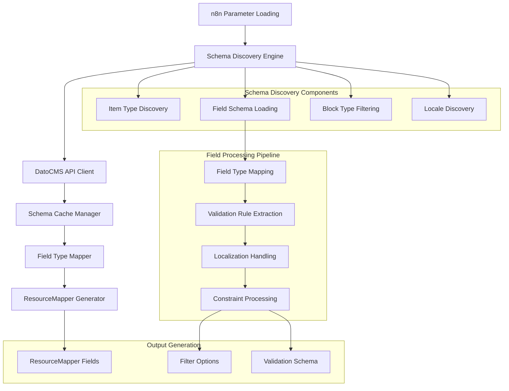

# Design Document

## Overview

The Dynamic Schema System serves as the foundation for intelligent field mapping and type-safe operations in the DatoCMS n8n node. It provides real-time discovery of DatoCMS content models, field schemas, and validation rules, enabling automatic ResourceMapper configuration and comprehensive field validation. The system implements sophisticated caching strategies, error handling, and seamless integration with n8n's parameter loading lifecycle to deliver a smooth user experience.

## Architecture

### High-Level Architecture



### Component Architecture

The Dynamic Schema System consists of several interconnected components:

1. **Schema Discovery Engine**: Orchestrates schema loading operations
2. **Cache Management Layer**: Handles schema caching and invalidation
3. **Field Type Mapping System**: Maps DatoCMS types to ResourceMapper types
4. **Validation Engine**: Processes and applies field validation rules
5. **Localization Handler**: Manages multi-language field configurations
6. **Integration Layer**: Provides seamless n8n integration

## Components and Interfaces

### Schema Discovery Engine

**Purpose**: Orchestrate all schema discovery operations and coordinate between different discovery components

**Key Interfaces**:
```typescript
interface SchemaDiscoveryEngine {
  discoverItemTypes(filter?: string): Promise<ItemTypeResult[]>;
  discoverBlockTypes(filter?: string): Promise<BlockTypeResult[]>;
  loadFieldSchema(itemTypeId: string): Promise<FieldSchema[]>;
  loadFilterableFields(itemTypeId: string): Promise<FilterableField[]>;
  loadSiteLocales(): Promise<SiteLocale[]>;
  invalidateCache(itemTypeId?: string): void;
}

interface ItemTypeResult {
  id: string;
  name: string;
  apiKey: string;
  singleton: boolean;
  modularBlock: boolean;
  description?: string;
}

interface BlockTypeResult extends ItemTypeResult {
  modularBlock: true;
}

interface FieldSchema {
  id: string;
  apiKey: string;
  label: string;
  fieldType: string;
  localized: boolean;
  required: boolean;
  unique: boolean;
  position: number;
  validators: ValidationRule[];
  appearance: AppearanceConfig;
}

interface FilterableField {
  id: string;
  name: string;
  value: string;
  description: string;
  fieldType: string;
  localized: boolean;
  unique: boolean;
}

interface SiteLocale {
  id: string;
  code: string;
  name: string;
  default: boolean;
}
```

### Cache Management System

**Purpose**: Implement intelligent caching to reduce API calls and improve performance

**Key Interfaces**:
```typescript
interface CacheManager {
  get<T>(key: string): T | null;
  set<T>(key: string, value: T, ttl?: number): void;
  invalidate(key: string): void;
  invalidatePattern(pattern: string): void;
  clear(): void;
  getStats(): CacheStats;
}

interface CacheStats {
  hits: number;
  misses: number;
  size: number;
  hitRate: number;
}

interface CacheKey {
  itemTypes: string;
  blockTypes: string;
  fieldSchema: (itemTypeId: string) => string;
  filterableFields: (itemTypeId: string) => string;
  siteLocales: string;
}
```

**Caching Strategy Implementation**:
```typescript
class SchemaCache implements CacheManager {
  private cache = new Map<string, CacheEntry>();
  private stats = { hits: 0, misses: 0 };
  
  get<T>(key: string): T | null {
    const entry = this.cache.get(key);
    if (entry && entry.expiresAt > Date.now()) {
      this.stats.hits++;
      return entry.value as T;
    }
    
    if (entry) {
      this.cache.delete(key); // Remove expired entry
    }
    
    this.stats.misses++;
    return null;
  }
  
  set<T>(key: string, value: T, ttl: number = 300000): void { // 5 minutes default
    this.cache.set(key, {
      value,
      expiresAt: Date.now() + ttl,
      createdAt: Date.now()
    });
  }
}

interface CacheEntry {
  value: any;
  expiresAt: number;
  createdAt: number;
}
```

### Field Type Mapping System

**Purpose**: Map DatoCMS field types to appropriate ResourceMapper field types with proper validation

**Key Interfaces**:
```typescript
interface FieldTypeMapper {
  mapFieldType(datoCmsType: string, fieldConfig: FieldSchema): ResourceMapperFieldType;
  getValidationRules(fieldConfig: FieldSchema): ValidationRule[];
  isFilterableType(fieldType: string): boolean;
  requiresSpecialHandling(fieldType: string): boolean;
}

interface ResourceMapperFieldType {
  type: FieldType;
  displayName: string;
  required: boolean;
  defaultMatch: boolean;
  description?: string;
  options?: any;
}

enum DatoCMSFieldType {
  STRING = 'string',
  TEXT = 'text',
  INTEGER = 'integer',
  FLOAT = 'float',
  BOOLEAN = 'boolean',
  DATE = 'date',
  DATETIME = 'datetime',
  FILE = 'file',
  GALLERY = 'gallery',
  LINK = 'link',
  LINKS = 'links',
  JSON = 'json',
  MODULAR_CONTENT = 'modular_content',
  STRUCTURED_TEXT = 'structured_text',
  VIDEO = 'video',
  COLOR = 'color',
  SLUG = 'slug',
  SEO = 'seo'
}
```

**Field Type Mapping Logic**:
```typescript
const fieldTypeMapping: Record<string, FieldType> = {
  'string': FieldType.String,
  'text': FieldType.String,
  'integer': FieldType.Number,
  'float': FieldType.Number,
  'boolean': FieldType.Boolean,
  'date': FieldType.DateTime,
  'datetime': FieldType.DateTime,
  'file': FieldType.String, // Asset reference
  'gallery': FieldType.Array,
  'link': FieldType.String, // Record reference
  'links': FieldType.Array,
  'json': FieldType.Object,
  'video': FieldType.String,
  'color': FieldType.String,
  'slug': FieldType.String,
  'seo': FieldType.Object
};

const mapFieldToResourceMapper = (field: FieldSchema): ResourceMapperField => {
  const baseType = fieldTypeMapping[field.fieldType] || FieldType.String;
  const isLocalized = field.localized === true;
  const isRequired = field.validators.some(v => v.type === 'required');
  const isUnique = field.validators.some(v => v.type === 'unique');
  
  // Use string type for localized fields to allow JSON input
  const fieldType = isLocalized ? FieldType.String : baseType;
  
  // Build display name with indicators
  let displayName = field.label;
  if (isUnique) displayName += ' (Unique)';
  if (isLocalized) displayName += ' (Localized)';
  
  return {
    id: field.apiKey,
    displayName,
    type: fieldType,
    required: isRequired,
    defaultMatch: isUnique, // Unique fields are good for matching
    description: buildFieldDescription(field)
  };
};
```

### Validation Engine

**Purpose**: Process and apply comprehensive field validation rules from DatoCMS schema

**Key Interfaces**:
```typescript
interface ValidationEngine {
  extractValidationRules(field: FieldSchema): ValidationRule[];
  validateFieldValue(value: any, rules: ValidationRule[]): ValidationResult;
  buildValidationSchema(fields: FieldSchema[]): ValidationSchema;
}

interface ValidationRule {
  type: 'required' | 'unique' | 'length' | 'range' | 'format' | 'custom';
  parameters: any;
  message?: string;
}

interface ValidationResult {
  isValid: boolean;
  errors: ValidationError[];
}

interface ValidationError {
  field: string;
  rule: string;
  message: string;
  value: any;
}

interface ValidationSchema {
  fields: Record<string, FieldValidation>;
  globalRules: ValidationRule[];
}

interface FieldValidation {
  required: boolean;
  type: string;
  rules: ValidationRule[];
  localized: boolean;
}
```

**Validation Rule Processing**:
```typescript
const extractValidationRules = (field: FieldSchema): ValidationRule[] => {
  const rules: ValidationRule[] = [];
  
  // Process DatoCMS validators
  field.validators.forEach(validator => {
    switch (validator.type) {
      case 'required':
        rules.push({
          type: 'required',
          parameters: {},
          message: `${field.label} is required`
        });
        break;
        
      case 'length':
        rules.push({
          type: 'length',
          parameters: {
            min: validator.min,
            max: validator.max
          },
          message: `${field.label} must be between ${validator.min} and ${validator.max} characters`
        });
        break;
        
      case 'number_range':
        rules.push({
          type: 'range',
          parameters: {
            min: validator.min,
            max: validator.max
          },
          message: `${field.label} must be between ${validator.min} and ${validator.max}`
        });
        break;
        
      case 'unique':
        rules.push({
          type: 'unique',
          parameters: {},
          message: `${field.label} must be unique`
        });
        break;
    }
  });
  
  return rules;
};
```

### Localization Handler

**Purpose**: Manage multi-language field configurations and locale-specific data processing

**Key Interfaces**:
```typescript
interface LocalizationHandler {
  detectLocalizedFields(fields: FieldSchema[]): LocalizedField[];
  processLocalizedData(data: any, localizedFields: string[]): ProcessedLocaleData;
  validateLocaleStructure(data: any, requiredLocales: string[]): LocaleValidationResult;
  formatLocalizedOutput(data: any, locales: SiteLocale[]): any;
}

interface LocalizedField {
  apiKey: string;
  label: string;
  required: boolean;
  supportedLocales: string[];
}

interface ProcessedLocaleData {
  [fieldKey: string]: {
    [localeCode: string]: any;
  };
}

interface LocaleValidationResult {
  isValid: boolean;
  missingLocales: string[];
  invalidStructure: string[];
  errors: LocaleError[];
}

interface LocaleError {
  field: string;
  locale: string;
  error: string;
}
```

**Localized Data Processing**:
```typescript
const processLocalizedField = (value: any, field: FieldSchema): any => {
  if (!field.localized) {
    return value;
  }
  
  // Handle JSON string input for localized fields
  if (typeof value === 'string' && value.trim().startsWith('{')) {
    try {
      return JSON.parse(value);
    } catch (error) {
      throw new Error(`Invalid JSON format for localized field ${field.label}: ${error.message}`);
    }
  }
  
  // Handle object input
  if (typeof value === 'object' && value !== null) {
    return value;
  }
  
  // For simple values, create single-locale structure
  return { [defaultLocale]: value };
};
```

### Integration Layer

**Purpose**: Provide seamless integration with n8n's parameter loading and ResourceMapper systems

**Key Interfaces**:
```typescript
interface N8nIntegrationLayer {
  loadOptionsForParameter(parameterName: string, context: ILoadOptionsFunctions): Promise<INodePropertyOptions[]>;
  searchListForParameter(parameterName: string, filter: string, context: ILoadOptionsFunctions): Promise<INodeListSearchResult>;
  generateResourceMapperFields(itemTypeId: string, context: ILoadOptionsFunctions): Promise<ResourceMapperFields>;
  handleCredentialAccess(context: ILoadOptionsFunctions): Promise<DatoCMSCredentials>;
}

interface DatoCMSCredentials {
  apiToken: string;
  environment: string;
  baseUrl?: string;
}
```

**n8n Method Implementations**:
```typescript
// List search implementation for item types
const searchItemTypes = async (context: ILoadOptionsFunctions, filter?: string): Promise<INodeListSearchResult> => {
  const credentials = await context.getCredentials('datoCmsApi');
  const client = buildClient({
    apiToken: credentials.apiToken as string,
    environment: credentials.environment as string,
  });
  
  try {
    // Check cache first
    const cacheKey = `itemTypes_${filter || 'all'}`;
    let itemTypes = cache.get<ItemType[]>(cacheKey);
    
    if (!itemTypes) {
      itemTypes = await client.itemTypes.list();
      cache.set(cacheKey, itemTypes, 300000); // 5 minutes
    }
    
    const results = itemTypes
      .filter(itemType => !filter || itemType.name.toLowerCase().includes(filter.toLowerCase()))
      .map(itemType => ({
        name: itemType.name,
        value: itemType.id,
      }));
    
    return { results };
  } catch (error) {
    throw new NodeOperationError(context.getNode(), `Failed to load item types: ${error.message}`);
  }
};
```

## Data Models

### Schema Data Models

```typescript
// Complete Item Type Model
interface ItemTypeSchema {
  id: string;
  type: 'item_type';
  attributes: {
    name: string;
    api_key: string;
    singleton: boolean;
    modular_block: boolean;
    sortable: boolean;
    tree: boolean;
    draft_mode_active: boolean;
    all_locales_required: boolean;
    collection_appearance: string;
    has_singleton_item: boolean;
    ordering_direction: string | null;
    ordering_field: {
      id: string;
      type: 'field';
    } | null;
  };
  relationships: {
    fields: {
      data: Array<{
        id: string;
        type: 'field';
      }>;
    };
    singleton_item?: {
      data: {
        id: string;
        type: 'item';
      } | null;
    };
  };
}

// Complete Field Schema Model
interface FieldSchemaData {
  id: string;
  type: 'field';
  attributes: {
    label: string;
    api_key: string;
    field_type: string;
    localized: boolean;
    position: number;
    hint?: string;
    validators: Record<string, any>;
    appearance: Record<string, any>;
    default_value?: any;
  };
  relationships: {
    item_type: {
      data: {
        id: string;
        type: 'item_type';
      };
    };
  };
}

// Site Locale Model
interface SiteLocaleData {
  id: string;
  type: 'locale';
  attributes: {
    code: string;
    name: string;
    default: boolean;
    fallback_locale?: string;
  };
}
```

### ResourceMapper Integration Models

```typescript
// ResourceMapper Field Configuration
interface ResourceMapperFieldConfig {
  id: string;
  displayName: string;
  type: FieldType;
  required: boolean;
  defaultMatch: boolean;
  description?: string;
  options?: {
    loadOptionsMethod?: string;
    values?: Array<{
      name: string;
      value: any;
    }>;
  };
}

// Complete ResourceMapper Fields Response
interface ResourceMapperFieldsResponse {
  fields: ResourceMapperFieldConfig[];
  metadata: {
    itemTypeId: string;
    itemTypeName: string;
    totalFields: number;
    localizedFields: number;
    requiredFields: number;
    uniqueFields: number;
  };
}
```

## Error Handling

### Error Classification

```typescript
enum SchemaErrorType {
  API_ACCESS = 'api_access',
  AUTHENTICATION = 'authentication',
  PERMISSION = 'permission',
  NETWORK = 'network',
  CACHE = 'cache',
  VALIDATION = 'validation',
  SCHEMA_PARSE = 'schema_parse'
}

interface SchemaError {
  type: SchemaErrorType;
  message: string;
  context: {
    operation: string;
    itemTypeId?: string;
    fieldId?: string;
  };
  recoverable: boolean;
  suggestions: string[];
}
```

### Error Handling Strategies

1. **API Access Errors**: Provide clear credential and permission guidance
2. **Network Errors**: Implement retry logic with exponential backoff
3. **Cache Errors**: Graceful fallback to direct API calls
4. **Schema Parse Errors**: Detailed parsing error information
5. **Validation Errors**: Field-specific validation feedback

## Testing Strategy

### Unit Testing

**Schema Discovery Tests**:
- Test item type loading and filtering
- Validate field schema processing
- Test cache behavior and invalidation

**Field Mapping Tests**:
- Test field type mapping logic
- Validate validation rule extraction
- Test localized field handling

**Integration Tests**:
- Test n8n method implementations
- Validate ResourceMapper integration
- Test error handling scenarios

### Performance Testing

**Cache Performance Tests**:
- Test cache hit rates and performance
- Validate memory usage patterns
- Test cache invalidation strategies

**Load Testing**:
- Test with large numbers of item types
- Validate performance with complex schemas
- Test concurrent schema loading

## Performance Considerations

### Optimization Strategies

1. **Intelligent Caching**: Multi-level caching with TTL management
2. **Lazy Loading**: Load schemas only when needed
3. **Batch Operations**: Group related API calls
4. **Memory Management**: Efficient cache size management
5. **Request Deduplication**: Avoid duplicate API calls

### Scalability Measures

1. **Cache Size Limits**: Prevent unbounded cache growth
2. **Request Throttling**: Respect API rate limits
3. **Memory Monitoring**: Track memory usage patterns
4. **Performance Metrics**: Monitor schema loading performance