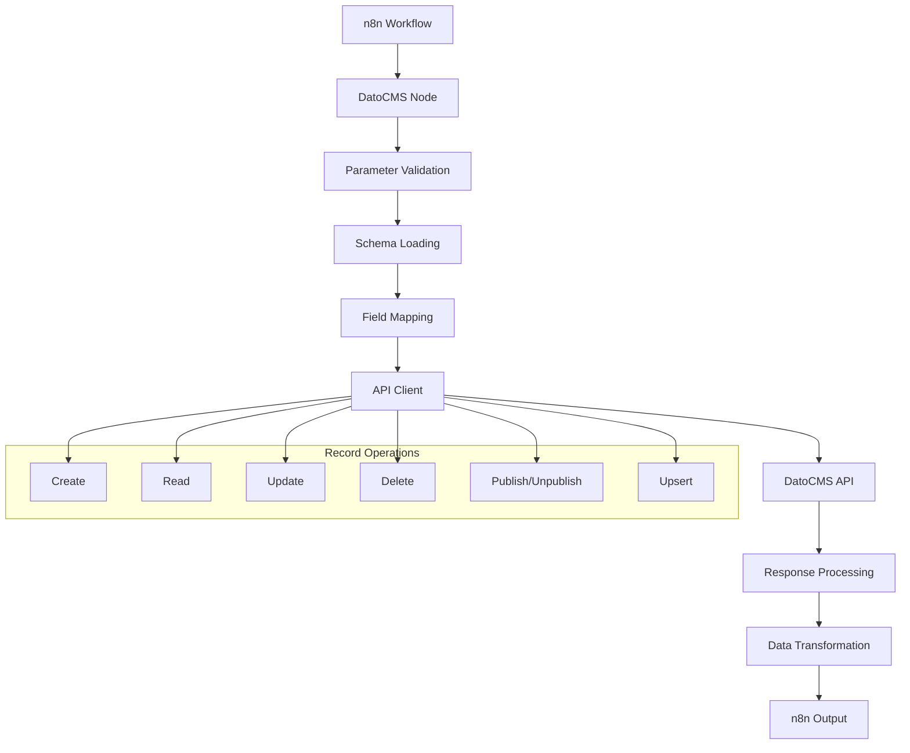

# Design Document

## Overview

The Record Management System is implemented as part of the main DatoCMS n8n node, providing comprehensive record operations through a resource-based architecture. The system leverages n8n's ResourceLocator and ResourceMapper patterns to provide dynamic, schema-aware field mapping with real-time validation. The design emphasizes type safety, performance optimization, and seamless integration with DatoCMS's Content Management API.

## Architecture

### High-Level Architecture



### Component Architecture

The Record Management System consists of several key components:

1. **Parameter Definition Layer**: Defines UI parameters using n8n patterns
2. **Schema Discovery Layer**: Dynamically loads DatoCMS schemas
3. **Field Mapping Layer**: Transforms user input to API format
4. **API Integration Layer**: Handles DatoCMS API communication
5. **Data Processing Layer**: Processes and transforms data
6. **Error Handling Layer**: Manages errors and provides user feedback

## Components and Interfaces

### Parameter Definition Component

**Purpose**: Define user interface parameters for record operations

**Key Interfaces**:
```typescript
interface RecordOperationParameters {
  resource: 'record';
  operation: 'create' | 'get' | 'getAll' | 'update' | 'delete' | 'bulkDelete' | 'publish' | 'unpublish' | 'upsert';
  itemType: ResourceLocatorValue;
  recordId?: string;
  recordIds?: string[];
  fields?: ResourceMapperFields;
  filters?: FixedCollectionValue;
  additionalFields?: {
    autoPublish?: boolean;
  };
  createIfNotFound?: boolean;
  nested?: boolean;
  returnAll?: boolean;
  limit?: number;
}
```

**Implementation Pattern**:
- Use `resourceLocator` for item type selection
- Use `resourceMapper` for field mapping
- Use `fixedCollection` for filter configuration
- Use `displayOptions` for conditional parameter visibility

### Schema Discovery Component

**Purpose**: Load and cache DatoCMS field schemas for dynamic UI generation

**Key Methods**:
```typescript
interface SchemaDiscovery {
  searchItemTypes(filter?: string): Promise<INodeListSearchResult>;
  getModelFields(itemTypeId: string): Promise<ResourceMapperFields>;
  getFilterableFields(itemTypeId: string): Promise<INodePropertyOptions[]>;
  cacheSchema(itemTypeId: string, schema: any): void;
  getCachedSchema(itemTypeId: string): any | null;
}
```

**Caching Strategy**:
- Cache item type lists for dropdown performance
- Cache field schemas to reduce API calls
- Implement cache invalidation for schema changes
- Use memory-based caching within execution context

### Field Mapping Component

**Purpose**: Transform ResourceMapper field configurations to DatoCMS API format

**Key Interfaces**:
```typescript
interface FieldMappingProcessor {
  processCreateFields(fields: ResourceMapperFields, inputData: any): any;
  processUpdateFields(fields: ResourceMapperFields, inputData: any): any;
  processUpsertFields(fields: ResourceMapperFields, inputData: any, matchingFields: string[]): {
    matchingData: any;
    updateData: any;
  };
  validateFieldTypes(fields: any, schema: any): ValidationResult;
}

interface ValidationResult {
  isValid: boolean;
  errors: FieldError[];
}

interface FieldError {
  field: string;
  message: string;
  type: 'required' | 'type' | 'format' | 'constraint';
}
```

**Field Type Handling**:
- **String Fields**: Direct mapping with validation
- **Numeric Fields**: Type conversion and range validation
- **Boolean Fields**: Boolean conversion with fallbacks
- **Date Fields**: ISO date string formatting
- **File Fields**: Asset reference handling
- **Link Fields**: Record reference validation
- **Localized Fields**: Multi-locale data structure

### API Integration Component

**Purpose**: Handle all DatoCMS API communication with proper error handling

**Key Interfaces**:
```typescript
interface DatoCMSApiClient {
  createRecord(itemTypeId: string, data: any, options?: CreateOptions): Promise<any>;
  getRecord(recordId: string, options?: GetOptions): Promise<any>;
  getRecords(itemTypeId: string, filters?: FilterOptions, options?: ListOptions): Promise<any[]>;
  updateRecord(recordId: string, data: any, options?: UpdateOptions): Promise<any>;
  deleteRecord(recordId: string): Promise<void>;
  bulkDeleteRecords(recordIds: string[]): Promise<BulkDeleteResult>;
  publishRecord(recordId: string): Promise<any>;
  unpublishRecord(recordId: string): Promise<any>;
  upsertRecord(itemTypeId: string, matchingData: any, updateData: any, options?: UpsertOptions): Promise<UpsertResult>;
}

interface CreateOptions {
  autoPublish?: boolean;
}

interface GetOptions {
  nested?: boolean;
}

interface FilterOptions {
  filters: Array<{
    field: string;
    operator: string;
    value: any;
  }>;
}

interface ListOptions {
  limit?: number;
  returnAll?: boolean;
  nested?: boolean;
}

interface UpsertOptions {
  createIfNotFound?: boolean;
  autoPublish?: boolean;
}

interface UpsertResult {
  record: any;
  operation: 'created' | 'updated';
}

interface BulkDeleteResult {
  successful: string[];
  failed: Array<{
    id: string;
    error: string;
  }>;
}
```

**Client Configuration**:
```typescript
const client = buildClient({
  apiToken: credentials.apiToken as string,
  environment: credentials.environment as string,
  logLevel: LogLevel.BODY,
});
```

### Data Processing Component

**Purpose**: Process and transform data between n8n and DatoCMS formats

**Key Methods**:
```typescript
interface DataProcessor {
  processInputData(items: INodeExecutionData[], operation: string): ProcessedInput[];
  transformApiResponse(response: any, operation: string, metadata?: any): any;
  formatBulkResults(results: any[], operation: string): BulkOperationResult;
  handleNestedData(record: any, schema: any): any;
}

interface ProcessedInput {
  data: any;
  metadata: {
    itemIndex: number;
    operation: string;
    itemTypeId?: string;
  };
}

interface BulkOperationResult {
  summary: {
    total: number;
    successful: number;
    failed: number;
  };
  results: any[];
  errors: any[];
}
```

**Data Transformation Rules**:
- Preserve original data structure where possible
- Add operation metadata for traceability
- Handle localized content appropriately
- Convert DatoCMS references to usable format
- Maintain type consistency across operations

## Data Models

### Core Data Structures

```typescript
// Record Data Model
interface DatoCMSRecord {
  id: string;
  type: string;
  attributes: {
    [fieldName: string]: any;
  };
  relationships?: {
    [relationName: string]: {
      data: RecordReference | RecordReference[];
    };
  };
  meta: {
    created_at: string;
    updated_at: string;
    published_at?: string;
    first_published_at?: string;
    publication_scheduled_at?: string;
    unpublishing_scheduled_at?: string;
    status: 'draft' | 'published';
    is_valid: boolean;
    is_current_version: boolean;
  };
}

interface RecordReference {
  id: string;
  type: string;
}

// Field Schema Model
interface FieldSchema {
  id: string;
  type: string;
  api_key: string;
  label: string;
  field_type: string;
  localized: boolean;
  required: boolean;
  position: number;
  validators: {
    [validatorName: string]: any;
  };
  appearance: {
    [appearanceKey: string]: any;
  };
}

// Item Type Model
interface ItemType {
  id: string;
  type: string;
  name: string;
  api_key: string;
  singleton: boolean;
  modular_block: boolean;
  sortable: boolean;
  tree: boolean;
  ordering_direction: string | null;
  ordering_field: FieldSchema | null;
}
```

### Operation-Specific Models

```typescript
// Filter Model
interface RecordFilter {
  field: string;
  operator: 'eq' | 'neq' | 'gt' | 'gte' | 'lt' | 'lte' | 'in' | 'notIn' | 'exists';
  value?: any;
}

// Upsert Configuration
interface UpsertConfiguration {
  matchingFields: string[];
  updateFields: ResourceMapperFields;
  createIfNotFound: boolean;
  autoPublish: boolean;
}

// Bulk Operation Configuration
interface BulkDeleteConfiguration {
  recordIds: string[];
  continueOnFail: boolean;
}
```

## Error Handling

### Error Classification

```typescript
enum ErrorType {
  AUTHENTICATION = 'authentication',
  AUTHORIZATION = 'authorization',
  VALIDATION = 'validation',
  NOT_FOUND = 'not_found',
  RATE_LIMIT = 'rate_limit',
  NETWORK = 'network',
  API_ERROR = 'api_error',
  INTERNAL = 'internal'
}

interface ErrorContext {
  operation: string;
  itemIndex?: number;
  recordId?: string;
  itemTypeId?: string;
  field?: string;
}
```

### Error Handling Strategy

1. **API Errors**: Map DatoCMS API errors to user-friendly messages
2. **Validation Errors**: Provide field-specific validation feedback
3. **Network Errors**: Distinguish temporary vs permanent failures
4. **Rate Limiting**: Provide retry guidance and backoff strategies
5. **Permission Errors**: Graceful degradation with limited functionality
6. **Bulk Operation Errors**: Continue processing with error collection

### Error Response Format

```typescript
interface ErrorResponse {
  error: {
    type: ErrorType;
    message: string;
    details?: any;
    context: ErrorContext;
    suggestions?: string[];
  };
}
```

## Testing Strategy

### Unit Testing

**Parameter Definition Tests**:
- Validate parameter visibility logic
- Test resource locator configurations
- Verify resource mapper configurations

**Schema Discovery Tests**:
- Mock DatoCMS API responses
- Test caching behavior
- Validate field type mapping

**Field Mapping Tests**:
- Test field transformation logic
- Validate type conversions
- Test localized field handling

**API Integration Tests**:
- Mock API client behavior
- Test error handling scenarios
- Validate request formatting

### Integration Testing

**End-to-End Operation Tests**:
- Test complete operation flows
- Validate data transformation
- Test error propagation

**Schema Integration Tests**:
- Test with real DatoCMS schemas
- Validate field discovery
- Test schema caching

**Performance Tests**:
- Test with large datasets
- Validate memory usage
- Test concurrent operations

### Error Scenario Testing

**API Error Tests**:
- Test authentication failures
- Test rate limiting scenarios
- Test network failures

**Validation Error Tests**:
- Test required field validation
- Test type validation
- Test constraint validation

**Edge Case Tests**:
- Test empty datasets
- Test malformed input
- Test schema changes

## Performance Considerations

### Optimization Strategies

1. **Schema Caching**: Cache field schemas to reduce API calls
2. **Connection Reuse**: Reuse DatoCMS client connections
3. **Batch Processing**: Group operations where possible
4. **Lazy Loading**: Load schemas only when needed
5. **Memory Management**: Efficient handling of large datasets

### Scalability Measures

1. **Concurrent Processing**: Handle multiple items efficiently
2. **Rate Limit Respect**: Honor DatoCMS API limits
3. **Resource Cleanup**: Proper cleanup of temporary resources
4. **Memory Optimization**: Efficient memory usage patterns

### Monitoring Points

1. **Operation Performance**: Track execution times
2. **API Usage**: Monitor API call patterns
3. **Error Rates**: Track error frequencies
4. **Cache Effectiveness**: Monitor cache hit rates