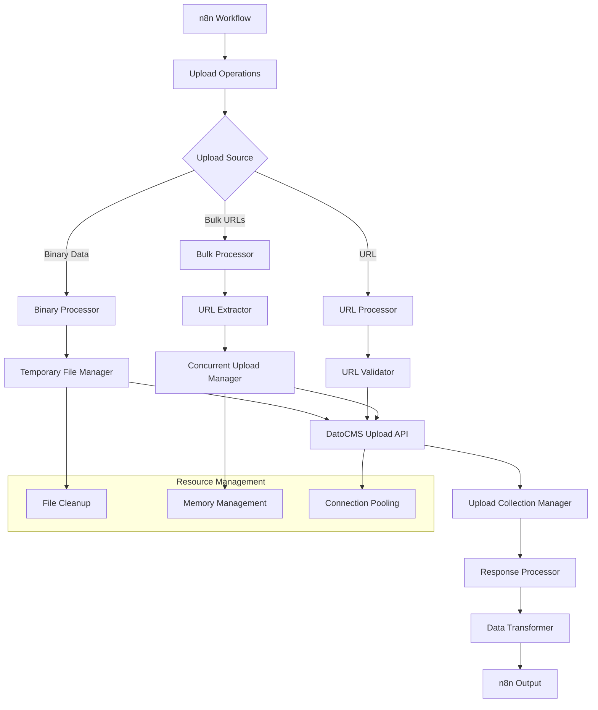

# Design Document

## Overview

The Upload Management System is implemented as part of the main DatoCMS n8n node, providing comprehensive file and asset management capabilities. The system supports both single and bulk upload operations from multiple sources (binary data, URLs), with advanced features like automatic URL extraction, concurrent processing, deduplication, and seamless integration with DatoCMS upload collections. The design emphasizes performance, resource management, and user experience through progress tracking and detailed error reporting.

## Architecture

### High-Level Architecture



### Component Architecture

The Upload Management System consists of several specialized components:

1. **Upload Source Handler**: Manages different upload sources (binary, URL, bulk)
2. **File Processing Layer**: Handles file validation, temporary storage, and cleanup
3. **URL Processing Layer**: Validates, extracts, and processes URLs
4. **Bulk Operations Manager**: Handles concurrent uploads with resource management
5. **Collection Management**: Organizes uploads in DatoCMS collections
6. **Resource Management Layer**: Manages temporary files, memory, and connections

## Components and Interfaces

### Upload Source Handler Component

**Purpose**: Route upload operations based on source type and manage source-specific logic

**Key Interfaces**:
```typescript
interface UploadSourceHandler {
  processBinaryUpload(binaryData: IBinaryData, options: BinaryUploadOptions): Promise<UploadResult>;
  processUrlUpload(url: string, options: UrlUploadOptions): Promise<UploadResult>;
  processBulkUpload(sources: BulkUploadSources, options: BulkUploadOptions): Promise<BulkUploadResult>;
}

interface BinaryUploadOptions {
  skipCreationIfAlreadyExists: boolean;
  uploadCollection?: string;
  includeOtherInputFields: boolean;
}

interface UrlUploadOptions {
  skipCreationIfAlreadyExists: boolean;
  uploadCollection?: string;
  includeOtherInputFields: boolean;
}

interface BulkUploadOptions {
  source: 'inputData' | 'urlList';
  extractFrom?: 'allFields' | 'specificFields';
  fieldNames?: string[];
  skipCreationIfAlreadyExists: boolean;
  uploadCollection?: string;
  includeOriginalData: boolean;
  replaceUrlsInData: boolean;
  concurrentUploads: number;
}

interface UploadResult {
  id: string;
  url: string;
  filename: string;
  size: number;
  mimeType: string;
  metadata: any;
  collection?: string;
}

interface BulkUploadResult {
  summary: {
    total: number;
    successful: number;
    failed: number;
    skipped: number;
  };
  uploads: UploadResult[];
  errors: UploadError[];
  originalData?: any;
  modifiedData?: any;
}
```

### File Processing Component

**Purpose**: Handle file validation, temporary storage, and cleanup operations

**Key Interfaces**:
```typescript
interface FileProcessor {
  createTemporaryFile(binaryData: IBinaryData): Promise<TemporaryFile>;
  validateFile(filePath: string): Promise<FileValidationResult>;
  cleanupTemporaryFile(filePath: string): Promise<void>;
  getFileMetadata(filePath: string): Promise<FileMetadata>;
}

interface TemporaryFile {
  path: string;
  filename: string;
  size: number;
  mimeType: string;
  cleanup: () => Promise<void>;
}

interface FileValidationResult {
  isValid: boolean;
  errors: string[];
  metadata: FileMetadata;
}

interface FileMetadata {
  filename: string;
  size: number;
  mimeType: string;
  extension: string;
  dimensions?: {
    width: number;
    height: number;
  };
}
```

**Implementation Strategy**:
```typescript
// Temporary file creation with automatic cleanup
const createTemporaryFile = async (binaryData: IBinaryData): Promise<TemporaryFile> => {
  const tempFilePath = join(tmpdir(), `n8n-datocms-${Date.now()}-${Math.random().toString(36).substr(2, 9)}`);
  
  try {
    writeFileSync(tempFilePath, binaryData.data, 'base64');
    
    return {
      path: tempFilePath,
      filename: binaryData.fileName || 'upload',
      size: Buffer.from(binaryData.data, 'base64').length,
      mimeType: binaryData.mimeType || 'application/octet-stream',
      cleanup: async () => {
        try {
          unlinkSync(tempFilePath);
        } catch (error) {
          // Log cleanup error but don't fail
        }
      }
    };
  } catch (error) {
    // Cleanup on failure
    try {
      unlinkSync(tempFilePath);
    } catch (cleanupError) {
      // Ignore cleanup errors
    }
    throw error;
  }
};
```

### URL Processing Component

**Purpose**: Handle URL validation, extraction, and processing for URL-based uploads

**Key Interfaces**:
```typescript
interface UrlProcessor {
  validateUrl(url: string): Promise<UrlValidationResult>;
  extractUrlsFromData(data: any, options: UrlExtractionOptions): string[];
  processUrlList(urlList: string): string[];
  downloadAndUpload(url: string, options: UploadOptions): Promise<UploadResult>;
}

interface UrlValidationResult {
  isValid: boolean;
  url: string;
  errors: string[];
  metadata?: {
    contentType?: string;
    contentLength?: number;
    filename?: string;
  };
}

interface UrlExtractionOptions {
  extractFrom: 'allFields' | 'specificFields';
  fieldNames?: string[];
  supportNestedFields: boolean;
}
```

**URL Extraction Logic**:
```typescript
const extractUrlsFromData = (data: any, options: UrlExtractionOptions): string[] => {
  const urls: string[] = [];
  const urlRegex = /https?:\/\/[^\s<>"{}|\\^`[\]]+/gi;
  
  const extractFromValue = (value: any, path: string = '') => {
    if (typeof value === 'string') {
      const matches = value.match(urlRegex);
      if (matches) {
        urls.push(...matches);
      }
    } else if (Array.isArray(value)) {
      value.forEach((item, index) => extractFromValue(item, `${path}[${index}]`));
    } else if (value && typeof value === 'object') {
      Object.keys(value).forEach(key => {
        const newPath = path ? `${path}.${key}` : key;
        if (options.extractFrom === 'allFields' || 
            options.fieldNames?.some(field => newPath.includes(field))) {
          extractFromValue(value[key], newPath);
        }
      });
    }
  };
  
  extractFromValue(data);
  return [...new Set(urls)]; // Remove duplicates
};
```

### Bulk Operations Manager Component

**Purpose**: Manage concurrent uploads with resource control and progress tracking

**Key Interfaces**:
```typescript
interface BulkOperationsManager {
  processConcurrentUploads(urls: string[], options: ConcurrentUploadOptions): Promise<BulkUploadResult>;
  manageResourceUsage(activeUploads: number): void;
  trackProgress(completed: number, total: number): void;
}

interface ConcurrentUploadOptions {
  concurrentLimit: number;
  skipCreationIfAlreadyExists: boolean;
  uploadCollection?: string;
  continueOnFail: boolean;
}
```

**Concurrent Processing Implementation**:
```typescript
const processConcurrentUploads = async (urls: string[], options: ConcurrentUploadOptions): Promise<BulkUploadResult> => {
  const results: UploadResult[] = [];
  const errors: UploadError[] = [];
  let skipped = 0;
  
  // Create upload tasks
  const uploadTasks = urls.map(url => async () => {
    try {
      const result = await uploadFromUrl(url, {
        skipCreationIfAlreadyExists: options.skipCreationIfAlreadyExists,
        uploadCollection: options.uploadCollection
      });
      
      if (result.skipped) {
        skipped++;
      } else {
        results.push(result);
      }
    } catch (error) {
      errors.push({
        url,
        error: error.message,
        timestamp: new Date().toISOString()
      });
      
      if (!options.continueOnFail) {
        throw error;
      }
    }
  });
  
  // Execute with concurrency control
  await executeWithConcurrency(uploadTasks, options.concurrentLimit);
  
  return {
    summary: {
      total: urls.length,
      successful: results.length,
      failed: errors.length,
      skipped
    },
    uploads: results,
    errors
  };
};
```

### Collection Management Component

**Purpose**: Handle upload collection organization and management

**Key Interfaces**:
```typescript
interface CollectionManager {
  loadUploadCollections(): Promise<UploadCollection[]>;
  assignToCollection(uploadId: string, collectionId: string): Promise<void>;
  filterByCollection(uploads: UploadResult[], collectionId: string): UploadResult[];
  handleCollectionPermissions(): Promise<UploadCollection[]>;
}

interface UploadCollection {
  id: string;
  label: string;
  description?: string;
}
```

**Graceful Permission Handling**:
```typescript
const loadUploadCollections = async (): Promise<UploadCollection[]> => {
  try {
    const collections = await client.uploadCollections.list();
    return collections.map(collection => ({
      id: collection.id,
      label: collection.label,
      description: collection.description
    }));
  } catch (error) {
    if (error.message?.includes('INSUFFICIENT_PERMISSIONS')) {
      // Graceful degradation - return empty list with note
      return [{
        id: '',
        label: '(None - Upload Collections Not Accessible)',
        description: 'Insufficient permissions to access upload collections'
      }];
    }
    throw error;
  }
};
```

### Data Transformation Component

**Purpose**: Transform upload results and handle URL replacement in data structures

**Key Interfaces**:
```typescript
interface DataTransformer {
  transformUploadResult(apiResult: any, metadata: any): UploadResult;
  replaceUrlsInData(data: any, urlMapping: Map<string, string>): any;
  formatBulkResults(results: BulkUploadResult, options: any): any;
  preserveDataStructure(originalData: any, modifications: any): any;
}
```

**URL Replacement Logic**:
```typescript
const replaceUrlsInData = (data: any, urlMapping: Map<string, string>): any => {
  const replaceInValue = (value: any): any => {
    if (typeof value === 'string') {
      // Check if this string is a URL that was uploaded
      const uploadId = urlMapping.get(value);
      if (uploadId) {
        return { upload_id: uploadId };
      }
      return value;
    } else if (Array.isArray(value)) {
      return value.map(item => replaceInValue(item));
    } else if (value && typeof value === 'object') {
      const result: any = {};
      Object.keys(value).forEach(key => {
        result[key] = replaceInValue(value[key]);
      });
      return result;
    }
    return value;
  };
  
  return replaceInValue(data);
};
```

## Data Models

### Core Upload Models

```typescript
// Upload Data Model
interface DatoCMSUpload {
  id: string;
  type: 'upload';
  attributes: {
    url: string;
    filename: string;
    size: number;
    mime_type: string;
    width?: number;
    height?: number;
    duration?: number;
    frame_rate?: number;
    created_at: string;
    updated_at: string;
    path: string;
    basename: string;
    format: string;
    is_image: boolean;
    is_video: boolean;
    is_audio: boolean;
    blurhash?: string;
    colors?: Array<{
      red: number;
      green: number;
      blue: number;
      alpha: number;
    }>;
    exif_info?: any;
    smart_tags?: string[];
    custom_data?: any;
  };
  relationships?: {
    upload_collection?: {
      data?: {
        id: string;
        type: 'upload_collection';
      };
    };
  };
}

// Upload Collection Model
interface UploadCollectionData {
  id: string;
  type: 'upload_collection';
  attributes: {
    label: string;
    description?: string;
    created_at: string;
    updated_at: string;
  };
}
```

### Operation-Specific Models

```typescript
// Bulk Upload Configuration
interface BulkUploadConfiguration {
  source: 'inputData' | 'urlList';
  extractionOptions: {
    extractFrom: 'allFields' | 'specificFields';
    fieldNames?: string[];
  };
  uploadOptions: {
    skipCreationIfAlreadyExists: boolean;
    uploadCollection?: string;
    concurrentUploads: number;
  };
  outputOptions: {
    includeOriginalData: boolean;
    replaceUrlsInData: boolean;
  };
}

// Upload Progress Tracking
interface UploadProgress {
  total: number;
  completed: number;
  failed: number;
  skipped: number;
  currentlyProcessing: string[];
  estimatedTimeRemaining?: number;
}

// Error Tracking
interface UploadError {
  url?: string;
  filename?: string;
  error: string;
  errorType: 'network' | 'validation' | 'api' | 'permission' | 'format';
  timestamp: string;
  retryable: boolean;
}
```

## Error Handling

### Error Classification

```typescript
enum UploadErrorType {
  NETWORK = 'network',
  VALIDATION = 'validation',
  FORMAT = 'format',
  SIZE_LIMIT = 'size_limit',
  PERMISSION = 'permission',
  API_ERROR = 'api_error',
  RESOURCE = 'resource',
  TIMEOUT = 'timeout'
}

interface UploadErrorContext {
  operation: 'create' | 'bulkCreate' | 'get' | 'getAll' | 'delete';
  source?: 'binary' | 'url' | 'bulk';
  url?: string;
  filename?: string;
  fileSize?: number;
  mimeType?: string;
}
```

### Error Handling Strategies

1. **Network Errors**: Retry logic with exponential backoff
2. **Format Errors**: Clear format support information
3. **Size Limit Errors**: Specific size limit guidance
4. **Permission Errors**: Graceful degradation with limited functionality
5. **Resource Errors**: Cleanup and resource management
6. **Bulk Operation Errors**: Continue processing with error collection

### Resource Management

```typescript
interface ResourceManager {
  trackTemporaryFiles(files: string[]): void;
  cleanupTemporaryFiles(): Promise<void>;
  monitorMemoryUsage(): MemoryUsage;
  manageConnectionPool(): void;
}

interface MemoryUsage {
  used: number;
  total: number;
  percentage: number;
  warning: boolean;
}
```

## Testing Strategy

### Unit Testing

**File Processing Tests**:
- Test temporary file creation and cleanup
- Validate file metadata extraction
- Test binary data handling

**URL Processing Tests**:
- Test URL validation logic
- Validate URL extraction from data structures
- Test nested field access

**Bulk Operations Tests**:
- Test concurrent upload management
- Validate resource usage control
- Test error handling in bulk operations

### Integration Testing

**API Integration Tests**:
- Test DatoCMS upload API integration
- Validate collection management
- Test error response handling

**End-to-End Tests**:
- Test complete upload workflows
- Validate data transformation
- Test resource cleanup

### Performance Testing

**Concurrent Upload Tests**:
- Test various concurrency levels
- Validate memory usage under load
- Test resource cleanup under stress

**Large File Tests**:
- Test large file handling
- Validate memory efficiency
- Test timeout handling

## Performance Considerations

### Optimization Strategies

1. **Concurrent Processing**: Configurable concurrency limits
2. **Memory Management**: Efficient handling of large files
3. **Resource Cleanup**: Automatic cleanup of temporary resources
4. **Connection Pooling**: Reuse HTTP connections for efficiency
5. **Deduplication**: Skip uploads for existing files
6. **Progress Tracking**: Efficient progress monitoring

### Scalability Measures

1. **Resource Limits**: Configurable limits for concurrent operations
2. **Memory Monitoring**: Track and manage memory usage
3. **Error Recovery**: Robust error handling and recovery
4. **Cleanup Automation**: Automatic resource cleanup

### Monitoring Points

1. **Upload Performance**: Track upload speeds and success rates
2. **Resource Usage**: Monitor memory and file system usage
3. **Error Rates**: Track error frequencies and types
4. **Concurrency Efficiency**: Monitor concurrent operation performance
